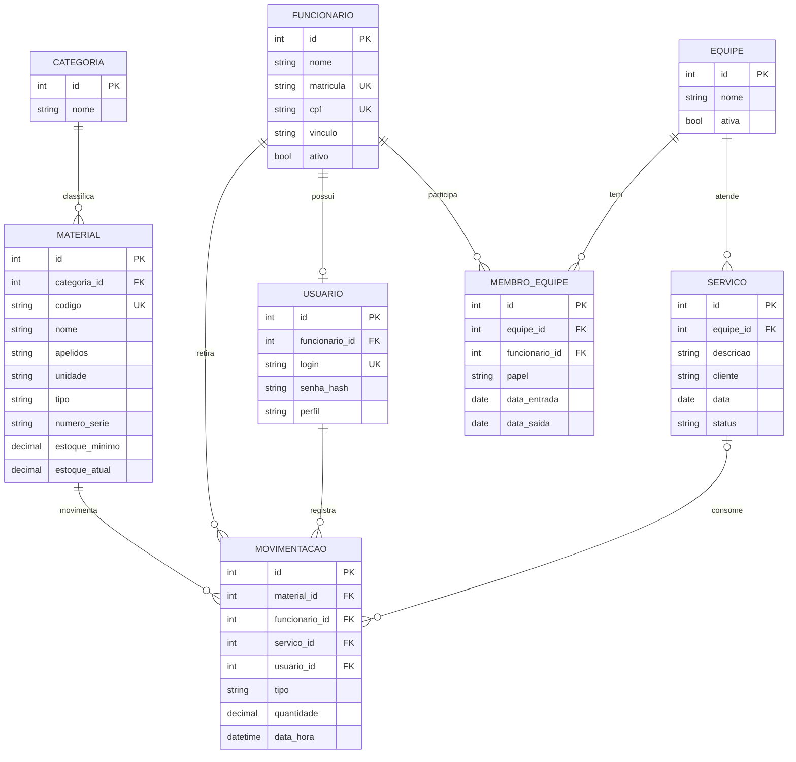

# Almoxa

**Sistema de gestão de materiais, funcionários e equipes.**

O Almoxa é um sistema web para controlar o **estoque de materiais e ferramentas**, o **cadastro de funcionários** (próprios e terceirizados) e a **montagem de equipes** de uma empresa de manutenção e instalação.

> 🚧 **Status:** em desenvolvimento (Fase 1 / MVP).

## Sobre o projeto

Projeto de estudo desenvolvido com base em um levantamento de requisitos simulado com um cliente fictício: uma empresa de médio porte que hoje controla tudo em planilhas, cadernos e grupos de WhatsApp. Os problemas que o sistema quer resolver:

- Falta de material em campo.
- Estoque que nunca bate, por falta de registro de entradas e saídas.
- Ferramentas que somem sem saber quem estava com elas.
- Dificuldade para saber qual equipe está livre e como as equipes são formadas.

## Funcionalidades

### Fase 1 (MVP)

- [ ] Cadastro de materiais, com código interno, apelidos, unidade e estoque mínimo
- [ ] Cadastro de funcionários (próprios, com matrícula, e terceirizados, só com CPF)
- [ ] Cadastro de equipes e seus membros, com histórico de trocas
- [ ] Registro de entrada, saída e devolução de material (quem, para qual serviço e quando)
- [ ] Controle de ferramentas (com quem estão e histórico de retiradas)
- [ ] Alerta de estoque baixo
- [ ] Controle de acesso por perfil (dono, almoxarife, RH e encarregado)
- [ ] Registro de auditoria (nada é alterado ou apagado sem deixar rastro)

### Fase 2

- [ ] Ordem de serviço ligando equipe, material usado e material devolvido
- [ ] Disponibilidade de equipes (férias, faltas, atestados)
- [ ] Controle de certificados e habilitações (ex.: NR-10, trabalho em altura), com aviso de vencimento
- [ ] Relatórios com exportação em Excel e PDF

### Fase 3

- [ ] Acesso pelo celular, com registro offline e sincronização
- [ ] Inventário (conferência periódica do estoque)
- [ ] Fornecedores e compras
- [ ] Anexo de fotos

## Tecnologias

- **C#** e **ASP.NET Core** (Web API)
- **Entity Framework Core** (Code First com migrations)
- **Banco de dados:** SQL Server ou PostgreSQL *(a definir)*
- **Front-end:** *(a definir)*

## Modelo de dados

Diagrama entidade-relacionamento da Fase 1:



### Principais decisões de modelagem

- **`MOVIMENTACAO`** concentra entradas, saídas e devoluções. O estoque nunca é editado direto: cada mudança é um registro, o que garante rastreabilidade.
- **`MEMBRO_EQUIPE`** resolve a relação muitos-para-muitos entre funcionários e equipes e guarda o histórico de quem passou por cada equipe.
- **`MATERIAL.tipo`** diferencia consumíveis (cabos, parafusos) de ferramentas (furadeira, escada).
- **`FUNCIONARIO.vinculo`** diferencia funcionários próprios de terceirizados.
- **`USUARIO`** é separado de `FUNCIONARIO`: nem todo funcionário precisa de acesso ao sistema.

## Perfis de usuário

| Perfil | Permissões |
|---|---|
| Dono | Visão geral de estoque, equipes, funcionários e relatórios |
| Almoxarife | Entradas, saídas, devoluções e inventário |
| RH | Funcionários, férias, faltas e certificados (sem acesso ao estoque) |
| Encarregado | Solicita e devolve material, vê a própria equipe |

## Como executar

### Pré-requisitos

- [.NET SDK](https://dotnet.microsoft.com/download) (versão LTS)
- Banco de dados configurado (SQL Server ou PostgreSQL)
- Git

### Passo a passo

```bash
# Clonar o repositório
git clone https://github.com/<seu-usuario>/almoxa.git
cd almoxa

# Restaurar as dependências
dotnet restore
```

Configure a string de conexão em `appsettings.Development.json`:

```json
{
  "ConnectionStrings": {
    "DefaultConnection": "<sua-string-de-conexao>"
  }
}
```

Aplique as migrations e rode o projeto:

```bash
dotnet ef database update
dotnet run
```

## Estrutura do projeto

*(a ser preenchida conforme o projeto for organizado)*

## Roadmap

O desenvolvimento segue as fases descritas em [Funcionalidades](#funcionalidades). A Fase 1 (MVP) é a prioridade atual.

## Autor

**Ravel**

## Licença

Defina a licença do projeto (por exemplo, MIT) e adicione o arquivo `LICENSE` na raiz do repositório.
